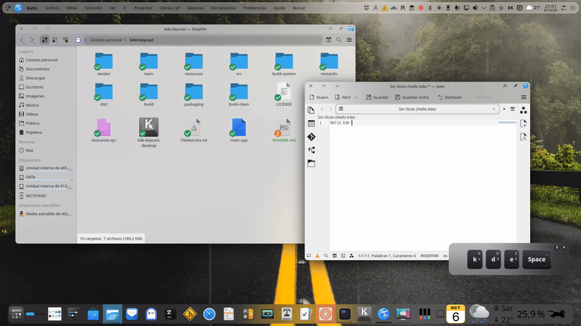
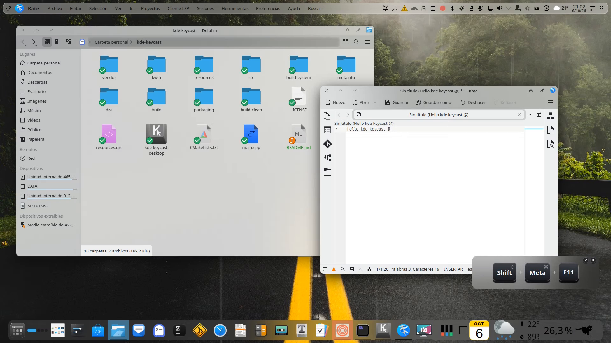

<p align="center"> <picture> <source media="(prefers-color-scheme: dark)" srcset="resources/icons/keycast-light.svg"> <source media="(prefers-color-scheme: light)" srcset="resources/icons/keycast-dark.svg">  </picture> </p>

<h1 align="center">KDE KeyCast</h1>

<p align="center"> Visual keyboard and mouse indicator for Linux/KDE, designed especially for presentations, tutorials, and screencasts. </p>

<p align="center">
  <a href="https://github.com/hgmarcury/kde-keycast/releases/latest">
    <strong>Download KDE KeyCast – Latest Release</strong>
  </a>
</p>

<p align="center">
  
</p>

<p align="center">
  
</p>

KDE KeyCast displays pressed keys and key combinations visually, using XKB to correctly interpret keyboard input according to the active keyboard layout.

## Features

- Captures keyboard events using the bundled ShowMeTheKey backend.
- Uses XKB to correctly resolve keys according to the system keyboard layout.
- Displays characters produced by `Shift`.
- Displays combinations involving `Ctrl`, `Alt`, `AltGr`, `Meta`, and `Shift` when appropriate.
- Represents special keys using appropriate names or symbols.
- Detects and displays mouse events, including mouse wheel scrolling.
- Includes a compact mode for displaying only relevant key combinations.
- Provides KDE/Plasma integration through a system tray icon.
- Includes optional KWin integration.

## Project status

KDE KeyCast is currently under development.

The main codebase has been reorganized into independent components to make the project easier to maintain and extend.

KDE KeyCast currently provides CMake-based installation and an AppImage build, including optional KWin integration.

## Dependencies

### Build dependencies

KDE KeyCast requires the following development dependencies:

- CMake
- A C/C++ compiler with C++17 support
- Extra CMake Modules (ECM)
- pkg-config
- Qt 6
- libxkbcommon
- Wayland
- libinput
- libudev
- libevdev

The project does **not** require an external installation of `showmethekey-cli`.

The ShowMeTheKey backend used by KDE KeyCast is included in the project and compiled from source. It is a modified version of ShowMeTheKey that adds support for detecting physical mouse wheel events.

### Runtime dependencies

Once installed, KDE KeyCast uses the corresponding runtime libraries for:

- Qt 6
- libxkbcommon
- Wayland
- libinput
- libudev
- libevdev

These libraries are normally provided by a modern Linux distribution running KDE Plasma.

### Input device permissions

KDE KeyCast needs permission to read keyboard and mouse events from Linux input devices under:

```text
/dev/input/event*
```

Depending on the distribution, these permissions may not be available to the current user by default.

There are two ways to grant access:

**Option 1: Use the `input` group**

On systems where this is the intended configuration, add the user to the group:

```bash
sudo usermod -aG input "$USER"
```

Log out and log in again for the new group membership to take effect.

**Security note:** Membership in `input` may grant access to input devices beyond those used by KDE KeyCast.

**Option 2: Configure optional KDE KeyCast Polkit permissions**

For system-wide installations, KDE KeyCast provides an optional configuration that creates a dedicated `kde-keycast` group and installs a Polkit rule for its bundled input backend.

To configure it, run:

```bash
configure-kde-keycast-permissions
```

The script explains the permissions and asks for confirmation before making system changes. Administrative privileges are required. Only users explicitly added to the dedicated group are granted this authorization, and the rule applies to local, active sessions.

To remove the permissions configured by this helper, run:

```bash
remove-kde-keycast-permissions
```

Users must log out and log in again after their group membership changes.

**Important:** This configuration grants sensitive access to keyboard and mouse events. Only authorize users you trust. Neither the group nor the active Polkit rule is created automatically during installation.

Without the required permissions, KDE KeyCast may start normally but will not display keyboard or mouse events.

### Optional KWin integration

KWin integration requires the following KDE tools:

- `kpackagetool6`
- `kwriteconfig6`
- `qdbus6`

These tools are not required to run KDE KeyCast normally.

## Building

The project uses CMake.

For example:

```bash
cmake -S . -B build
cmake --build build -j$(nproc)
```

To install into a local test directory:

```bash
cmake --install build --prefix "$(pwd)/build/test-install"
```

The following package instructions apply to building KDE KeyCast from source.

### Debian / Ubuntu / Kubuntu

On Debian-based distributions such as Ubuntu and Kubuntu:

```bash
sudo apt update
sudo apt install \
    build-essential \
    cmake \
    extra-cmake-modules \
    pkg-config \
    qt6-base-dev \
    libxkbcommon-dev \
    libwayland-dev \
    libinput-dev \
    libudev-dev \
    libevdev-dev
```

Then clone and build the project:

```bash
git clone https://github.com/hgmarcury/kde-keycast.git
cd kde-keycast
cmake -S . -B build
cmake --build build -j$(nproc)
```

### Installing from CMake

After building the project, KDE KeyCast can be installed into a chosen prefix:

```bash
cmake --install build --prefix "$HOME/.local"
```

For a system-wide installation:

```bash
sudo cmake --install build --prefix /usr/local
```

The installation includes KDE KeyCast, the bundled ShowMeTheKey backend, the desktop entry, icons, metadata, and the files required for optional KWin integration.

It also installs the following helper scripts:

- `uninstall-kde-keycast`
- `install-kwin-kde-keycast`
- `uninstall-kwin-kde-keycast`
- `configure-kde-keycast-permissions`
- `remove-kde-keycast-permissions`

KWin integration is optional and is not installed or enabled automatically by the CMake installation. It can be installed later from KDE KeyCast or with the dedicated `install-kwin-kde-keycast` helper.

### Installing from a clean system

After installing KDE KeyCast, make sure the current user has the required access to `/dev/input/event*` as described in [Input device permissions](#input-device-permissions).

Then launch:

```bash
kde-keycast
```

KDE KeyCast should report the use of its bundled ShowMeTheKey backend in the terminal.

## Uninstalling

A CMake installation can be removed using the installed `uninstall-kde-keycast` script.

For example, when installed into `/usr/local`:

```bash
sudo /usr/local/bin/uninstall-kde-keycast
```

When installed into the user's local prefix:

```bash
~/.local/bin/uninstall-kde-keycast
```

The `uninstall-kde-keycast` script removes the installed KDE KeyCast files and, as an exception, also removes the KDE KeyCast KWin integration if it is installed.

The dedicated `uninstall-kwin-kde-keycast` helper removes only the KWin integration.

User configuration is preserved.

### AppImage

An AppImage build is also available. It can install the KDE KeyCast desktop entry and application icons into the user's desktop environment:

```bash
./kde-keycast-x86_64.AppImage --install
```

KWin integration is optional and is not installed automatically.

KWin integration can then be installed from the KDE KeyCast application, or manually using the bundled KWin installer.

To remove the AppImage application integration:

```bash
./kde-keycast-x86_64.AppImage --uninstall
```

The AppImage uninstall operation also removes KWin integration if installed, unless a valid native KDE KeyCast installation is detected.

## Distribution-specific dependencies

### Debian / Ubuntu

The required packages are listed in the [Debian / Ubuntu / Kubuntu](#debian--ubuntu--kubuntu) section above.

### Fedora

KDE KeyCast has been tested successfully on **Fedora 44 KDE Plasma (Wayland)**.

Install the required build dependencies:

```bash
sudo dnf install \
    gcc \
    gcc-c++ \
    cmake \
    extra-cmake-modules \
    pkgconf-pkg-config \
    qt6-qtbase-devel \
    libxkbcommon-devel \
    wayland-devel \
    libinput-devel \
    systemd-devel \
    libevdev-devel
```

Clone the repository and build KDE KeyCast:

```bash
git clone https://github.com/hgmarcury/kde-keycast.git
cd kde-keycast
cmake -S . -B build
cmake --build build -j$(nproc)
```

Install it:

```bash
sudo cmake --install build
```

#### Input device permissions

KDE KeyCast reads input events from `/dev/input/event*`.

On Fedora, these devices are normally accessible to members of the `input` group. If your user is not already a member of this group, add it with:

```bash
sudo usermod -aG input $USER
```

Then log out and back in, or reboot.

You can verify the group membership with:

```bash
groups
```

The `input` group should be listed.

Without the required permissions, KDE KeyCast may start normally but will not display keyboard or mouse events.

#### Optional KWin integration

KWin integration is optional and can be installed from the KDE KeyCast application or manually with:

```bash
./packaging/install-kwin-kde-keycast.sh
```

To remove only the KWin integration:

```bash
./packaging/uninstall-kwin-kde-keycast.sh
```

Fedora provides the Qt 6 D-Bus utility as `qdbus-qt6` rather than `qdbus6`. KDE KeyCast automatically detects either name.

Package names may vary between Fedora releases.

### Arch Linux and EndeavourOS

KDE KeyCast has been tested successfully on **EndeavourOS KDE Plasma (Wayland)**, an Arch Linux-based distribution.

Expected packages on Arch Linux and EndeavourOS are:

```bash
sudo pacman -S \
    base-devel \
    cmake \
    extra-cmake-modules \
    pkgconf \
    qt6-base \
    libxkbcommon \
    wayland \
    libinput \
    libevdev
```

Clone the repository and build KDE KeyCast:

```bash
git clone https://github.com/hgmarcury/kde-keycast.git
cd kde-keycast
cmake -S . -B build
cmake --build build -j$(nproc)
```

Install it:

```bash
sudo cmake --install build
```

**Arch Linux itself has not yet been tested on a clean installation.** Package names and system configuration may vary between Arch-based distributions.

## Tested environments

KDE KeyCast has currently been tested successfully on:

- **KDE neon** — KDE Plasma on Wayland
- **Kubuntu 26.04.1 LTS** — KDE Plasma 6.6.6 on Wayland
- **Fedora 44 KDE** — KDE Plasma 6.7.5 on Wayland
- **EndeavourOS KDE** — KDE Plasma on Wayland

Additional distributions will be added here as they are tested on clean installations.

## Optional KWin integration

KDE KeyCast includes a script for optionally installing its KWin integration:

```text
install-kwin-kde-keycast
```

KWin integration is not enabled automatically when KDE KeyCast is installed.

The script can install, update, or remove the KWin script and reconfigure KWin when necessary.

KDE KeyCast can run normally without KWin integration.

## AppImage

The project includes tools and scripts for building an AppImage.

The resulting AppImage can be run directly without installation:

```bash
./dist/kde-keycast-x86_64.AppImage
```

The AppImage also provides optional installation and uninstallation helpers.

To install the AppImage for the current user:

```bash
./dist/kde-keycast-x86_64.AppImage --install
```

This creates the user's desktop launcher and icon files.
KWin integration is optional and is not installed or enabled automatically by the AppImage installation.

To remove the AppImage installation:

```bash
./dist/kde-keycast-x86_64.AppImage --uninstall
```

The AppImage uninstall operation also removes KWin integration if installed, unless a valid native KDE KeyCast installation is detected.

Detailed instructions for building the AppImage are available in:

```text
packaging/appimage/README.md
```

## License

The KDE KeyCast code is distributed under:

**GNU General Public License v3.0 or later (GPL-3.0-or-later)**

The full license text is available in:

```text
LICENSE
```

The bundled ShowMeTheKey backend is a separate component distributed under:

**Apache License 2.0**

Its original license is preserved in:

```text
vendor/showmethekey-cli/LICENSE
```

The backend has been modified for KDE KeyCast, including support for physical mouse wheel events.

Third-party libraries and components retain their respective licenses.

See `THIRD-PARTY-NOTICES` for additional information.

## Copyright

Copyright © 2026 Marc G.

KDE KeyCast is not an official KDE project and is not affiliated with KDE e.V.

## Contributing

KDE KeyCast is an open-source project, and contributions from the community are welcome!

Whether you're a user, developer or simply interested in the project, there are several ways to get involved:

- **Report a bug:** Found something that doesn't work as expected? [Open a bug report](https://github.com/hgmarcury/kde-keycast/issues/new/choose).
- **Suggest an improvement:** Have an idea for a new feature? [Submit a feature request](https://github.com/hgmarcury/kde-keycast/issues/new/choose).
- **Ask questions and share ideas:** Join [GitHub Discussions](https://github.com/hgmarcury/kde-keycast/discussions).
- **Contribute code:** Read our [Contributing Guidelines](CONTRIBUTING.md) to learn how to submit changes.

For significant changes, opening a discussion or issue before implementation is recommended.

Every contribution, suggestion and report is appreciated. Thank you for helping improve KDE KeyCast!

## Support the Project

If you find KDE KeyCast useful, you can support its continued development with a voluntary contribution on [Buy Me a Coffee](https://buymeacoffee.com/hgmarcury).

Your support is greatly appreciated and helps keep the project going. Thank you!

## Project

KDE KeyCast is developed as an independent project for Linux/KDE.

The goal is to provide a simple input indicator suitable for presentations, recordings, and screencasts.
